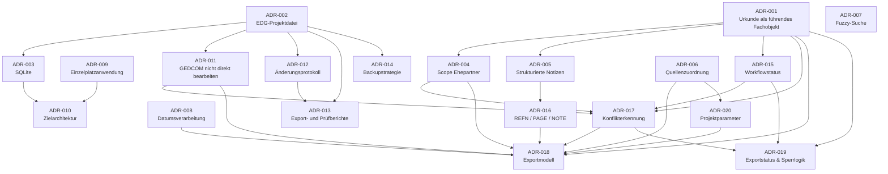

# ADR-Übersicht ged_editor

Diese Übersicht dient als schneller Einstieg in die Architekturentscheidungen des Projekts und zeigt die Entwicklung von den fachlichen Grundlagen bis zum Exportmodell.

| ADR | Titel | Kurzbeschreibung |
| --- | --- | --- |
| ADR-001 | Urkunde ist führendes Fachobjekt | Legt fest, dass die Urkunde das zentrale Fachobjekt der Anwendung ist. Alle Bearbeitungsschritte orientieren sich an einer Urkunde. |
| ADR-002 | Verwendung einer EDG-Projektdatei | Einführung der EDG-Datei als Arbeitsformat des Projektes. |
| ADR-003 | SQLite als internes Speicherformat | Die EDG-Datei basiert auf SQLite und dient als zentrale Persistenzschicht. |
| ADR-004 | Begrenzung des fachlichen Scopes auf Ehepartner | Das Projekt verarbeitet ausschließlich die Ehepartner einer Heiratsurkunde. Eltern werden nur dokumentiert. |
| ADR-005 | Strukturierte Erfassung von Urkundennotizen | Randvermerke, Herkunft, Todesvermerke und sonstige Informationen werden strukturiert erfasst. |
| ADR-006 | Quellenzuordnung erfolgt beim Export | Der verwendete GEDCOM-SOUR-Datensatz wird erst beim Export festgelegt. |
| ADR-007 | Personenzuordnung über Fuzzy-Suche | Bestehende Personen werden über eine Fuzzy-Suche vorgeschlagen, die Entscheidung trifft der Benutzer. |
| ADR-008 | Datumsverarbeitung | Datumeingabe erfolgt benutzerfreundlich, die GEDCOM-Darstellung wird daraus erzeugt. |
| ADR-009 | Einzelplatzanwendung | ged_editor ist ausdrücklich als Einzelplatzanwendung konzipiert. |
| ADR-010 | Zielarchitektur (Python + PySide6 + SQLite) | Definition des Technology-Stacks und der Schichtenarchitektur. |
| ADR-011 | GEDCOM wird nicht in Echtzeit bearbeitet | GEDCOM-Dateien werden importiert und exportiert, jedoch niemals direkt bearbeitet. |
| ADR-012 | Änderungsprotokoll und Revisionssicherheit | Alle relevanten Änderungen innerhalb eines Projektes werden nachvollziehbar protokolliert. |
| ADR-013 | Export- und Prüfberichte | Definition von Prüf- und Exportberichten zur Qualitätssicherung und Dokumentation. |
| ADR-014 | Backup- und Wiederherstellungsstrategie | Mehrstufige Backup-Strategie für Projektdateien und Wiederherstellung von Projektständen. |
| ADR-015 | Workflowstatusmodell für Urkunden | Zweistufiges Workflowmodell: „In Bearbeitung“ und „Fertig“ als Exportfreigabe. |
| ADR-016 | Bildung REFN, PAGE und NOTE | Definition der Erzeugung von REFN, SOUR.PAGE und SOUR.NOTE beim Export. |
| ADR-017a | Sequenzdiagramme | Unterstützende Diagramme für Export-, Konflikt- und Workflowabläufe. |
| ADR-017 | Konflikterkennung und selektiver Export | Regeln zur Erkennung veränderter oder gelöschter Datensätze und zum selektiven Export von Urkunden. |
| ADR-018 | Exportmodell und GEDCOM-Erzeugung | Beschreibt die technische Umsetzung des GEDCOM-Exports und die Behandlung bestehender bzw. neuer FAM- und INDI-Datensätze. |
| ADR-019 | Exportstatus, Sperrlogik und Wiederholungsexporte | Definiert Exportstatus, Sperrung exportierter Urkunden und Verhalten bei Wiederholungsexporten. |
| ADR-020 | Projektparameter und Exporteinstellungen | Definition projektweiter Vorgaben wie SOUR-Zeiger, MARR.TYPE, REFN-/PAGE-Präfixe und Standardwerte für die Erfassung. |

## Architekturblöcke
### Fachmodell

Grundlegende fachliche Entscheidungen:
```
ADR-001
ADR-004
ADR-005
ADR-015
ADR-016
```

Diese ADRs beschreiben:

* Urkundenmodell
* Personenmodell
* Notizen
* Workflow
* Exportdarstellung

### Datenhaltung

Definition des Arbeitsformates:

```
ADR-002
ADR-003
ADR-010
ADR-011
```

Diese ADRs beschreiben:

* EDG-Datei
* SQLite
* Schichtenmodell
* GEDCOM-Import/Export-Prinzip

### Qualitätssicherung

Nachvollziehbarkeit und Datensicherheit:

```
ADR-012
ADR-013
ADR-014
```

Diese ADRs definieren:

* Historisierung
* Berichte
* Backups

### Exportarchitektur

Der komplette Exportworkflow basiert auf:

```
ADR-006
ADR-016
ADR-017
ADR-018
ADR-019
ADR-020
```

Zusammen beschreiben diese ADRs:

```PLAIN TEXT
Projektdaten
        ↓
Exportfreigabe
        ↓
Konfliktprüfung
        ↓
GEDCOM-Erzeugung
        ↓
Statuswechsel
```

## Architekturleitbild

Die ADR-Sammlung verfolgt konsequent folgende Grundsätze:

1. Die Urkunde ist das führende Fachobjekt.
2. GEDCOM ist Austauschformat, EDG ist Arbeitsformat.
3. Der Benutzer trifft genealogische Entscheidungen.
4. Der Export erfolgt urkundenbezogen.
5. Bestehende Daten werden soweit möglich ergänzt und nicht zerstört.
6. Konflikte werden erkannt, dokumentiert und kontrolliert behandelt.
7. Die Anwendung bleibt bewusst einfach und als Einzelplatzlösung ausgelegt.

## Aktueller Reifegrad

Mit ADR-001 bis ADR-020 sind nun festgelegt:

 ✅ Fachmodell
 ✅ Datenmodell
 ✅ Workflowmodell
 ✅ Konfliktmodell
 ✅ Exportmodell
 ✅ Statusmodell
 ✅ Backupkonzept
 ✅ Berichtswesen
 ✅ Projektparameter
 ✅ Zielarchitektur

Die ADR-Sammlung beschreibt damit die vollständige fachliche und technische Grundlage für die Entwicklung von **ged_editor Version 1.0.**

---

# Fachliche Abhängigkeiten


## Architektur in Schichten

Die gleiche Struktur etwas verständlicher:
```Plain Text
                   ADR-001
        Urkunde als führendes Objekt
                          │
        ┌─────────────────┼─────────────────┐
        │                 │                 │
    ADR-004          ADR-005          ADR-015
      Scope           Notizen         Workflow
        │                 │               │
        │             ADR-016            │
        │          REFN/PAGE/NOTE        │
        └──────┬──────────┬──────────────┘
               │          │
            ADR-017   ADR-020
            Konflikte Parameter
               │          │
               └────┬─────┘
                    │
                 ADR-018
                 Export
                    │
                 ADR-019
              Exportstatus
```

Parallel dazu:

```Plain Text
ADR-002
EDG-Datei
    │
    ├── ADR-003 SQLite
    │       │
    │       └── ADR-010 Architektur
    │
    ├── ADR-011 GEDCOM-Trennung
    │
    ├── ADR-012 Protokollierung
    │       │
    │       └── ADR-013 Berichte
    │
    └── ADR-014 Backup
```

## Kritische Basis-ADRs
Aus heutiger Sicht (12.11.2026) tragen praktisch alle anderen Entscheidungen auf diesen sechs ADRs auf (Kern-Architektur):

```Plain Text
ADR-001  Urkunde als führendes Fachobjekt

ADR-002  EDG-Projektdatei

ADR-003  SQLite

ADR-010  Zielarchitektur

ADR-011  Keine direkte GEDCOM-Bearbeitung

ADR-015  Workflowstatusmodell
```

