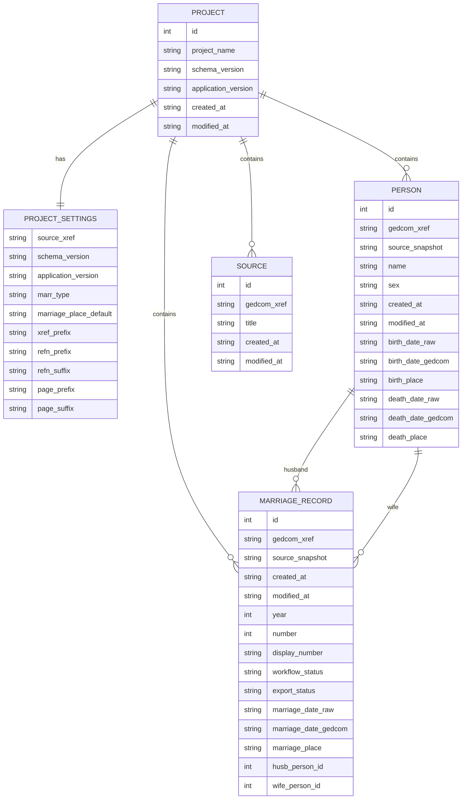

# DATA_MODEL.md

# Datenmodell von ged_editor

## Zweck

Dieses Dokument beschreibt das fachliche Datenmodell von ged_editor und die Beziehungen zwischen den zentralen Entitäten.

Die Definition basiert auf den ADRs 001 bis 021.

Insbesondere:

- ADR-001 Urkunde als führendes Fachobjekt
- ADR-015 Workflowstatusmodell
- ADR-017 Konflikterkennung und selektiver Export
- ADR-018 Exportmodell und GEDCOM-Erzeugung
- ADR-019 Exportstatus, Sperrlogik und Wiederholungsexporte
- ADR-020 Projektparameter und Exporteinstellungen
- ADR-021 MarriageRecord repräsentiert den GEDCOM-FAM-Datensatz

---

# Fachliches Gesamtmodell

```text
Project
    │
    ├── ProjectSettings
    │
    ├── MarriageRecord
    │        │
    │        ├── Husband → Person
    │        │
    │        └── Wife → Person
    │
    └── Source
```

---

# Entität: Project

## Fachliche Bedeutung

Repräsentiert ein EDG-Projekt.

Ein Projekt enthält:

- Urkunden
- Personen
- Quellen
- Projekteinstellungen

---

## Attribute

```text
id

project_name

created_at
modified_at

schema_version

application_version
```

---

# Entität: ProjectSettings

## Fachliche Bedeutung

Projektweite Einstellungen für Erfassung, Konfliktprüfung und Export.

Technisch werden diese Werte in der Tabelle:

```text
meta
```

gespeichert.

---

## Attribute

### Quellen

```text
source_xref
```

Verwendeter SOUR-Datensatz beim Export.

---

### Heirat

```text
marr_type
```

Zulässige Werte:

```text
CIVIL
RELIGIOUS
```

---

### Erfassungsvorgaben

```text
marriage_place_default
```

Standardwert für:

```text
MARR.PLAC
```

bei neuen Urkunden.

Der Wert kann pro Urkunde geändert werden.

---

### XREF-Erzeugung

```text
xref_prefix
```

Beispiel:

```text
H1905
```

Erzeugt:

```text
@IH19050001@
@FH19050001@
```

---

### REFN-Erzeugung

```text
refn_prefix
refn_suffix
```

---

### PAGE-Erzeugung

```text
page_prefix
page_suffix
```

### Systemparameter

```text
schema_version
application_version
```

Leere Werte sind für projektweite Einstellungsparameter zulässig.
`schema_version` und `application_version` werden durch die Anwendung verwaltet.

---

# Entität: MarriageRecord

## Fachliche Bedeutung

Repräsentiert eine Heiratsurkunde.

Gleichzeitig repräsentiert ein MarriageRecord den zugehörigen GEDCOM-FAM-Datensatz.

Der GEDCOM-FAM-Datensatz wird direkt durch MarriageRecord repräsentiert.

Gemäß ADR-001 ist MarriageRecord das führende Fachobjekt der Anwendung.

---

## Identifikation

```text
id

gedcom_xref

created_at

modified_at
```

### Bedeutung von gedcom_xref

Importierte Urkunde:

```text
@F471@
```

Neue Urkunde:

```text
NULL
```

Der XREF wird beim Export erzeugt.

---

## Urkundenidentifikation

```text
year

number

display_number
```

Bei importierten FAM-Datensätzen können `year` und `number` zunächst `NULL`
sein, wenn keine Urkundenidentifikation vorliegt.

Die Anzeigedarstellung:

```text
15/1887
```

wird aus diesen Feldern erzeugt; bei fehlender Urkundenidentifikation bleibt
`display_number` leer.

---

## Workflow

Gemäß ADR-015:

```text
workflow_status

In Bearbeitung
Fertig
```

---

## Export

Gemäß ADR-019:

```text
export_status

Nicht exportiert
Exportiert
Konflikt
```

---

## Konfliktprüfung

Gemäß ADR-017:

```text
source_snapshot
```

Speichert den beim Import vorhandenen Vergleichsstand.

Der Aufbau des Snapshots ist Implementierungsdetail.

---

## Personenbeziehungen

```text
husb_person_id

wife_person_id
```

---

## Heiratsdaten

```text
marriage_date_raw

marriage_date_gedcom

marriage_place
```

---

## Strukturierte Notizen

Gemäß ADR-005:

```text
note_origin_husband

note_origin_wife

note_death_husband

note_death_wife

note_legitimation

note_marginal

note_comments
```

---

# Entität: Person

## Fachliche Bedeutung

Personen repräsentieren den aktuellsten Wissensstand innerhalb eines Projektes.

Eine Person kann in mehreren Urkunden verwendet werden.

Personen besitzen keinen Workflowstatus und keinen Exportstatus.

---

## Attribute

```text
id

gedcom_xref

name

sex

created_at

modified_at
```

---

## Bedeutung von gedcom_xref

Importierte Person:

```text
@I471@
```

Neue Person:

```text
NULL
```

Der XREF wird beim Export erzeugt.

---

## Konfliktprüfung

Gemäß ADR-017:

```text
source_snapshot
```

Speichert den beim Import vorhandenen Vergleichsstand.

Der Aufbau des Snapshots ist Implementierungsdetail.

---

## Personenbezogene Daten

```text
birth_date_raw

birth_date_gedcom

birth_place

death_date_raw

death_date_gedcom

death_place
```

---

## Beziehungen

Eine Person kann mehrfach in MarriageRecords verwendet werden.

```text
Person
    1:n
MarriageRecord
```

---

# Entität: Source

## Fachliche Bedeutung

Repräsentiert einen GEDCOM-SOUR-Datensatz.

---

## Attribute

```text
id

gedcom_xref

title

created_at

modified_at
```

---

## Besonderheit

Die Zuordnung erfolgt erst beim Export gemäß ADR-006.

Es besteht keine direkte Verknüpfung zwischen MarriageRecord und Source.

---

# Tabellenbeziehungen

## Project → MarriageRecord

```text
Project
    1:n
MarriageRecord
```

---

## Project → Person

```text
Project
    1:n
Person
```

---

## Project → Source

```text
Project
    1:n
Source
```

---

## MarriageRecord → Person

```text
MarriageRecord

    husb_person_id
        ─────────► Person

    wife_person_id
        ─────────► Person
```

Beziehung:

```text
Person
    1:n
MarriageRecord
```

---

# Konzeptionelles Datenmodell

```text
+----------------+
|    Project     |
+----------------+
| id             |
| project_name   |
| schema_version |
| application_version |
| created_at     |
| modified_at    |
+----------------+
         |
         | 1:1
         |
         ▼
+------------------------+
|    ProjectSettings     |
+------------------------+
| source_xref            |
| schema_version         |
| application_version    |
| marr_type              |
| marriage_place_default |
| xref_prefix            |
| refn_prefix            |
| refn_suffix            |
| page_prefix            |
| page_suffix            |
+------------------------+

         |
         | 1:n
         |
         ▼

+------------------------+
|    MarriageRecord      |
+------------------------+
| id                     |
| gedcom_xref            |
| source_snapshot        |
| created_at             |
| modified_at            |
| year                   |
| number                 |
| display_number         |
| workflow_status        |
| export_status          |
| marriage_date_raw      |
| marriage_date_gedcom   |
| marriage_place         |
| husb_person_id         |
| wife_person_id         |
+------------------------+
         |           |
         |           |
       n:1         n:1
         |           |
         ▼           ▼

+------------------------+
|        Person          |
+------------------------+
| id                     |
| gedcom_xref            |
| source_snapshot        |
| name                   |
| sex                    |
| created_at             |
| modified_at            |
| birth_date_raw         |
| birth_date_gedcom      |
| birth_place            |
| death_date_raw         |
| death_date_gedcom      |
| death_place            |
+------------------------+

+------------------------+
|        Source          |
+------------------------+
| id                     |
| gedcom_xref            |
| title                  |
| created_at             |
| modified_at            |
+------------------------+
```

---

# Mermaid ER-Diagramm



---

# Modellierungsprinzipien

## 1. Urkunde ist führendes Fachobjekt

Alle Arbeitsabläufe orientieren sich an MarriageRecord.

---

## 2. MarriageRecord repräsentiert den GEDCOM-FAM-Datensatz

Der GEDCOM-FAM-Datensatz wird direkt durch MarriageRecord repräsentiert.

---

## 3. Personen sind projektweite Stammdaten

Personen können in mehreren Urkunden verwendet werden.

---

## 4. GEDCOM-Strukturen werden exportseitig erzeugt

Folgende Informationen werden nicht persistent gespeichert:

```text
REFN

SOUR.PAGE

SOUR.NOTE

FAMS
```

Diese Informationen werden gemäß ADR-016 und ADR-018 ausschließlich während des Exports erzeugt.

---

## 5. Konfliktprüfung verwendet Snapshots

Importierte Datensätze speichern einen Vergleichsstand:

```text
source_snapshot
```

Die interne Repräsentation ist Implementierungsdetail.

---

## 6. EDG ist das Arbeitsformat

GEDCOM-Dateien werden niemals direkt bearbeitet.

Gemäß ADR-011 erfolgt jede Bearbeitung innerhalb des EDG-Projektes.
