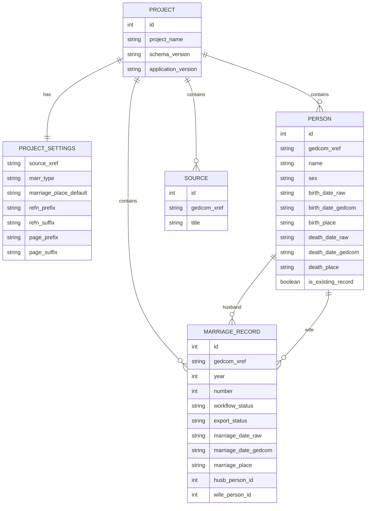

# DATA_MODEL.md

# Datenmodell von ged_editor

## Zweck

Dieses Dokument beschreibt das fachliche Datenmodell von ged_editor und die Beziehungen zwischen den zentralen Entitäten.

---

# Fachliches Gesamtmodell

```text
Project
    │
    ├── ProjectSettings
    │      │
    │      ├── source_xref
    │      ├── marr_type
    │      ├── marriage_place_default
    │      ├── refn_prefix
    │      ├── refn_suffix
    │      ├── page_prefix
    │      └── page_suffix
    │
    ├── MarriageRecord
    │        │
    │        ├── Husband → Person
    │        │
    │        └── Wife → Person
    │
    └── Source
```

---

# Entität: Project

Repräsentiert ein EDG-Projekt.

## Attribute

```text
id

project_name

created_at
modified_at

schema_version

application_version
```

---

# Entität: ProjectSettings

Projektweite Einstellungen.

## Wichtige Einträge

```text
source_xref

marr_type

refn_prefix
refn_suffix

page_prefix
page_suffix

marriage_place_default
```

---

# Entität: MarriageRecord

## Fachliche Bedeutung

Repräsentiert eine erfasste Heiratsurkunde.

Gleichzeitig repräsentiert sie den zugehörigen GEDCOM-FAM-Datensatz.

Gemäß ADR-001 ist MarriageRecord das führende Fachobjekt der Anwendung.

---

## Identifikation

```text
id

gedcom_xref

year
number

display_number
```

---

## Workflow

```text
workflow_status

In Bearbeitung
Fertig
```

---

## Export

```text
export_status

Nicht exportiert
Exportiert
Konflikt
```

---

## Personenbeziehungen

```text
husb_person_id

wife_person_id
```

---

## Heiratsdaten

```text
marriage_date_raw

marriage_date_gedcom

marriage_place
```

---

## Strukturierte Notizen

```text
note_origin_husband

note_origin_wife

note_death_husband

note_death_wife

note_legitimation

note_marginal

note_comments
```

---

# Entität: Person

## Fachliche Bedeutung

Personen repräsentieren den aktuellsten Wissensstand innerhalb eines Projektes.

Sie können in mehreren Urkunden vorkommen.

---

## Attribute

```text
id

gedcom_xref

name

sex

is_existing_record
```

---

## Personenbezogene Daten

```text
birth_date_raw
birth_date_gedcom
birth_place

death_date_raw
death_date_gedcom
death_place
```

---

## Beziehungen

```text
Person
    1:n
MarriageRecord
```

---

# Entität: Source

## Fachliche Bedeutung

Repräsentiert einen GEDCOM-SOUR-Datensatz.

---

## Attribute

```text
id

gedcom_xref

title
```

---

## Besonderheit

Die Zuordnung erfolgt erst beim Export gemäß ADR-006.

---

# Tabellenbeziehungen

```text
Project
    1:n MarriageRecord

MarriageRecord
    n:1 Person (Bräutigam)

MarriageRecord
    n:1 Person (Braut)
```

---

# Entity-Relationship-Diagramm

```text
+-----------+
|  Project  |
+-----------+
      |
      | 1:n
      |
      ▼

+------------------+
| MarriageRecord   |
+------------------+
| gedcom_xref      |
| year             |
| number           |
| workflow_status  |
| export_status    |
+------------------+
      |         |
      |         |
      ▼         ▼

 +---------+   +---------+
 | Husband |   |  Wife   |
 +---------+   +---------+
        \         /
         \       /
          ▼     ▼

          +---------+
          | Person  |
          +---------+
```


# Konzeptionelles Datenmodell

```text
+----------------+
|    Project     |
+----------------+
| id             |
| project_name   |
| schema_version |
+----------------+
         |
         | 1:1
         |
         ▼

+----------------+
|      ProjectSettings      |
+----------------+
| key            |
| value          |
+----------------+


         |
         | 1:n
         |
         ▼

+------------------------+
|    MarriageRecord      |
+------------------------+
| id                     |
| gedcom_xref            |
| year                   |
| number                 |
| workflow_status        |
| export_status          |
| marriage_date_raw      |
| marriage_date_gedcom   |
| marriage_place         |
| husb_person_id         |
| wife_person_id         |
+------------------------+
         |           |
         |           |
       n:1         n:1
         |           |
         ▼           ▼

+------------------------+
|        Person          |
+------------------------+
| id                     |
| gedcom_xref            |
| name                   |
| sex                    |
| birth_date_raw         |
| birth_date_gedcom      |
| birth_place            |
| death_date_raw         |
| death_date_gedcom      |
| death_place            |
+------------------------+


+------------------------+
|        Source          |
+------------------------+
| id                     |
| gedcom_xref            |
| title                  |
+------------------------+
```


---

# Modellierungsprinzipien

## 1. Urkunde ist führendes Fachobjekt

Alle Arbeitsabläufe orientieren sich an MarriageRecord.

---

## 2. MarriageRecord repräsentiert den FAM-Datensatz

Eine separate FamilyLink-Entität existiert nicht.

---

## 3. Personen sind projektweite Stammdaten

Personen können in mehreren Urkunden verwendet werden.

---

## 4. GEDCOM-Strukturen werden exportseitig erzeugt

Nicht persistent gespeichert:

```text
REFN

SOUR.PAGE

SOUR.NOTE

FAMS
```

Diese Informationen werden gemäß ADR-016 und ADR-018 ausschließlich beim Export erzeugt.

---

## 5. EDG ist das Arbeitsformat

GEDCOM-Dateien werden niemals direkt bearbeitet.

Gemäß ADR-011 erfolgt jede Bearbeitung innerhalb des EDG-Projektes.


---
# Mermaid ER-Diagramm
zur Dokumentation

